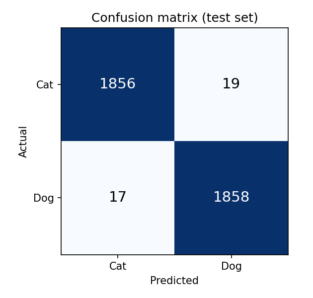
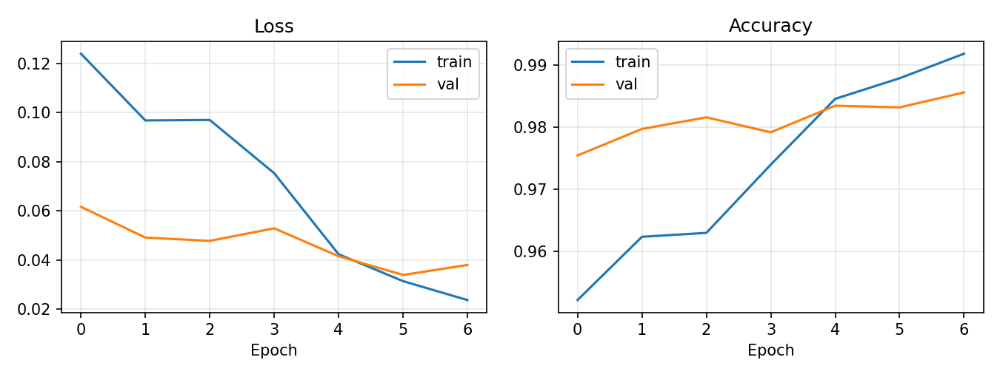

# Cat vs Dog Image Classification with Transfer Learning

**Deep Learning Semester Project**

| | |
|---|---|
| **Name** | Your Name |
| **Roll No** | Your Roll No |
| **Course** | Deep Learning |
| **Date** | 31 October 2026 |

**Project links**

- Live demo: https://projectclassificationmodel-web.vercel.app/
- Source code, dataset link and model weights: https://github.com/aizaz88/Project_Classification_Model
- Presentation slides: [`presentation/Project_Presentation.pptx`](../presentation/Project_Presentation.pptx)
- Presentation video and LinkedIn post: linked from the live demo page

---

## Abstract

This project builds an image classifier that decides whether a photograph shows a cat or a dog. A MobileNetV2 network pre-trained on ImageNet is fine-tuned with PyTorch on a Kaggle dataset of about 25,000 photos. On a held-out test set of 3,750 images the model reaches **99.04% accuracy** (36 mistakes), with precision, recall and F1 score of 99.04% as well. The trained network is exported to the ONNX format and deployed as a static website on Vercel, where it runs entirely inside the visitor's browser, so no server is needed and uploaded photos never leave the user's device. All code, the trained weights and links to the dataset are public on GitHub.

## 1. Introduction

### 1.1 Problem statement

Given a colour photograph, predict whether it shows a cat or a dog. This is a binary image classification problem. Although it looks easy to a human, the two classes vary enormously in breed, colour, pose, background, lighting and image quality, so a classifier must learn robust visual features rather than simple colour or texture cues.

### 1.2 Objectives

1. Select a dataset and prepare it for training, validation and testing.
2. Train a deep learning model with transfer learning and save its weights.
3. Evaluate the model on unseen data with standard classification metrics.
4. Publish the source code, dataset link and weights in a public GitHub repository.
5. Deploy a web interface that demonstrates the model's predictions.

### 1.3 Why transfer learning

Training a convolutional network from scratch needs a very large dataset and a lot of computing time. A network pre-trained on ImageNet (1.28 million images, 1,000 classes) has already learned general visual features such as edges, textures, fur patterns and eyes. Re-using these features and adapting only the final layers gives high accuracy with far less data and training time.

## 2. Dataset

| Item | Detail |
|---|---|
| Type | Secondary dataset (downloaded, not collected by the author) |
| Name | Dog and Cat Classification Dataset |
| Source | Kaggle: https://www.kaggle.com/datasets/bhavikjikadara/dog-and-cat-classification-dataset |
| Content | About 25,000 JPEG photographs in two folders, `Cat` and `Dog`, in roughly equal numbers |
| Image size | Varies from image to image (resized during preprocessing) |

### 2.1 Cleaning

Files that cannot be opened as images are removed before training. After cleaning, 24,998 images remained. A second safeguard in the data loader skips any file that fails to decode during training.

### 2.2 Train, validation and test split

The data was split with a stratified 70 / 15 / 15 split and a fixed random seed (42), so every subset keeps the same cat-to-dog ratio and the split can be reproduced exactly.

| Subset | Images | Share | Purpose |
|---|---:|---:|---|
| Training | 17,498 | 70.0% | Learning the model weights |
| Validation | 3,750 | 15.0% | Choosing the best epoch |
| Test | 3,750 | 15.0% | Final, unbiased evaluation (1,875 cats and 1,875 dogs) |

The test images were never used for training or for model selection.

## 3. Methodology

### 3.1 Preprocessing and augmentation

All images are converted to RGB and normalised with the ImageNet mean (0.485, 0.456, 0.406) and standard deviation (0.229, 0.224, 0.225), which is what the pre-trained network expects.

| Stage | Transformations |
|---|---|
| Training | Random resized crop to 224 x 224 (scale 0.7 to 1.0), random horizontal flip, colour jitter (brightness, contrast and saturation 0.2) |
| Validation and test | Resize to 256 pixels, centre crop to 224 x 224 |

Random augmentation shows the network a slightly different version of each photo every epoch, which reduces over-fitting. Evaluation images are transformed deterministically so that results are repeatable.

### 3.2 Model architecture

The model is **MobileNetV2** (Sandler et al., 2018), a compact convolutional network built from inverted residual blocks with depthwise separable convolutions. It was chosen because it is accurate, small (about 9 MB after export) and fast enough to run in a web browser.

The original 1,000-class output layer is replaced by a new classification head:

```
Input image (3 x 224 x 224)
   -> MobileNetV2 feature extractor (ImageNet pre-trained, 1280 features)
   -> Dropout (p = 0.3)
   -> Linear (1280 -> 2)
   -> Output: logits for [Cat, Dog]
```

The network has about 2.23 million parameters in total.

### 3.3 Training procedure

Training is done in two phases, a common recipe for transfer learning.

| Setting | Phase 1: train the head | Phase 2: fine-tune everything |
|---|---|---|
| Epochs | 3 | 4 |
| Trainable layers | New classification head only | All layers |
| Learning rate | 1e-3 | 1e-4 |

Other settings, shared by both phases:

| Setting | Value |
|---|---|
| Framework | PyTorch and torchvision |
| Optimiser | AdamW (weight decay 1e-4) |
| Loss function | Cross-entropy |
| Batch size | 32 |
| Random seed | 42 |
| Model selection | The epoch with the highest validation accuracy is kept |

In phase 1 the pre-trained features are frozen so that the randomly initialised head can settle without damaging them. In phase 2 the whole network is fine-tuned with a ten times smaller learning rate, so the pre-trained features are adapted gently to cats and dogs.

### 3.4 Evaluation metrics

The final model is evaluated once on the test set using accuracy, precision, recall and F1 score (averaged over both classes) and a confusion matrix.

## 4. Implementation

The project is organised as follows in the GitHub repository:

| Path | Contents |
|---|---|
| `src/common.py` | Data loading, splits, transforms, model definition and metric helpers |
| `src/download_data.py` | Downloads the Kaggle dataset |
| `src/train.py` | Two-phase training, evaluation, saving the weights and exporting to ONNX |
| `src/evaluate.py` | Re-evaluates saved weights on the test split |
| `src/predict.py` | Predicts a single image from the command line |
| `src/export_onnx.py` | Converts the PyTorch weights to ONNX and checks that both outputs agree |
| `models/` | Trained PyTorch weights (`catdog_mobilenetv2.pth`) |
| `web/` | The deployed website (HTML, CSS, JavaScript and `model/catdog.onnx`) |
| `report/`, `presentation/` | This report and the project slides |

## 5. Results

### 5.1 Overall performance

Results on the held-out test set of 3,750 images:

| Accuracy | Precision | Recall | F1 score |
|---:|---:|---:|---:|
| 99.04% | 99.04% | 99.04% | 99.04% |

Precision, recall and F1 are averaged over the two classes. The result is 3,714 correct predictions out of 3,750.

### 5.2 Per-class performance

| Class | Precision | Recall | F1 score | Test images |
|---|---:|---:|---:|---:|
| Cat | 99.09% | 98.99% | 99.04% | 1,875 |
| Dog | 98.99% | 99.09% | 99.04% | 1,875 |

### 5.3 Confusion matrix



| | Predicted Cat | Predicted Dog |
|---|---:|---:|
| **Actual Cat** | 1,856 | 19 |
| **Actual Dog** | 17 | 1,858 |

The model made 36 mistakes (0.96% of the test set): 19 cats were labelled as dogs and 17 dogs were labelled as cats. The two error counts are almost equal, so the model shows no meaningful bias towards either class.

### 5.4 Training behaviour



- **Loss:** training loss falls steadily from about 0.12 to about 0.024 over the 7 epochs. Validation loss falls from about 0.06 to a minimum near 0.034 and ends at about 0.038.
- **Accuracy:** training accuracy rises from about 95.2% to about 99.2%. Validation accuracy rises from about 97.5% to about 98.6%, and the last epoch had the highest validation accuracy, so it was the one kept.
- **Early epochs:** validation accuracy is higher than training accuracy at first. This is expected, because the training images are augmented, dropout is active during training, and the backbone is frozen in the first phase.
- **Over-fitting:** after fine-tuning begins, the training curve rises above the validation curve and the two end about 0.6 percentage points apart. This is a small gap and the validation loss did not rise sharply, so over-fitting is mild. The test accuracy (99.04%) is slightly above the validation accuracy; with 3,750 images per subset the difference is about 18 images, which is normal sampling variation.

### 5.5 Discussion

A pre-trained MobileNetV2 reaches over 99% accuracy after only seven epochs, which confirms that ImageNet features transfer very well to this task. The remaining errors are most likely hard cases such as unusual poses, partly hidden animals, tiny animals in large scenes, low-quality photos and images that contain both animals. A manual review of the 36 misclassified test images would confirm this and is listed under future work.

## 6. Deployment

### 6.1 Export to ONNX

After training, the weights are exported to the ONNX format (`web/model/catdog.onnx`, about 8.9 MB). The export script runs a random test image through both the PyTorch model and the ONNX model and fails if their outputs differ, so the deployed model is guaranteed to behave like the trained one.

### 6.2 Web application

The web interface is a static site (HTML, CSS and JavaScript) deployed on Vercel from the `web/` folder of the GitHub repository. It uses ONNX Runtime Web to run the model in the browser:

1. The visitor drops, pastes or selects a photo.
2. JavaScript resizes it to 256 pixels, centre-crops it to 224 x 224 and normalises it with the same mean and standard deviation used in training.
3. The ONNX model returns two scores, which are converted to probabilities with a softmax function.
4. The page shows the predicted class and the probability of each class.

Because inference runs on the visitor's device, the website needs no server, costs nothing to run, and **uploaded photos are never sent anywhere**. The page also shows the dataset details, results, code links and project links, as required. Every push to GitHub redeploys the site automatically.

## 7. Limitations

- **Only two classes.** The model has just two outputs, and its probabilities always add up to 100% over cat and dog. It therefore cannot say "neither". In manual testing with photos of other animals, such as a pig and a lion cub, the model still gave a confident cat or dog answer. This is a known weakness of closed-set classifiers, not a bug in the code.
- **Single dataset and single split.** All results come from one dataset, one random split and one training run. Photos from other sources, such as other cameras or unusual lighting, may give lower accuracy, and results could differ by a fraction of a percent with another seed.
- **No error analysis by image type.** The 36 mistakes were counted but not yet reviewed individually.

## 8. Future work

1. **Add an "Other" class.** Train a three-class model (Cat, Dog, Other) using photos of other animals, objects and scenes, with cats and dogs filtered out, so the app can answer "neither a cat nor a dog". Look-alike animals such as lions, wolves and pigs should be included and repeated more often during training.
2. **Confidence threshold.** Answer "neither" whenever the top probability is below a chosen threshold (for example 70%), as a safety net for images unlike anything seen in training.
3. **Evaluate on unseen categories.** Hold some "Other" categories out of training to measure honestly how well the model rejects things it has never seen.
4. **Error analysis.** Review the misclassified images and add targeted training data or augmentation for the failure cases.
5. **Further improvements.** Try larger backbones such as EfficientNet, test-time augmentation, repeated runs with different seeds, and extend the task to breed recognition.

## 9. Reproducibility

```bash
git clone https://github.com/aizaz88/Project_Classification_Model.git
cd Project_Classification_Model
pip install -r requirements.txt

python src/download_data.py        # downloads the Kaggle dataset
python src/train.py                # trains, saves weights, exports ONNX
python src/evaluate.py             # test-set metrics from the saved weights
python src/predict.py pet.jpg      # predict a single image
```

The data split, model initialisation and training use a fixed seed (42). The trained weights are in `models/catdog_mobilenetv2.pth` and can be loaded without retraining:

```python
import sys; sys.path.insert(0, "src")
from common import load_model, eval_tf, CLASSES
from PIL import Image

model = load_model("models/catdog_mobilenetv2.pth")
x = eval_tf()(Image.open("pet.jpg").convert("RGB")).unsqueeze(0)
print(CLASSES[model(x).argmax(1).item()])
```

## 10. Conclusion

The project shows the full workflow of a deep learning application: choosing and cleaning a dataset, training a model with transfer learning, evaluating it on unseen data, publishing the code and weights, and deploying an interactive demo. A fine-tuned MobileNetV2 classifies cats and dogs with 99.04% test accuracy, and exporting it to ONNX lets it run privately in any web browser. Testing outside the training classes also exposed an important limitation of two-class models, which points directly to the next improvement: an "Other" class and a confidence threshold.

## References

1. M. Sandler, A. Howard, M. Zhu, A. Zhmoginov and L.-C. Chen, "MobileNetV2: Inverted Residuals and Linear Bottlenecks", *IEEE/CVF Conference on Computer Vision and Pattern Recognition (CVPR)*, 2018.
2. J. Deng, W. Dong, R. Socher, L.-J. Li, K. Li and L. Fei-Fei, "ImageNet: A Large-Scale Hierarchical Image Database", *CVPR*, 2009.
3. A. Paszke et al., "PyTorch: An Imperative Style, High-Performance Deep Learning Library", *Advances in Neural Information Processing Systems (NeurIPS)*, 2019.
4. I. Loshchilov and F. Hutter, "Decoupled Weight Decay Regularization" (AdamW), *ICLR*, 2019.
5. Kaggle, "Dog and Cat Classification Dataset": https://www.kaggle.com/datasets/bhavikjikadara/dog-and-cat-classification-dataset
6. ONNX Runtime Web documentation: https://onnxruntime.ai/docs/tutorials/web/
